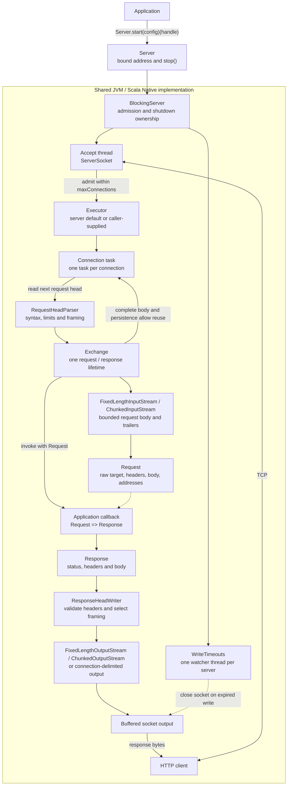

# Architecture

The same blocking HTTP/1 core runs on JVM and Scala Native. Applications supply
configuration and a synchronous `Request => Response` callback.

Connections can run concurrently; exchanges on each connection run sequentially.
The default executor uses a cached platform-thread pool with no task queue.
`Server.start(config, executor)(handle)` accepts a caller-owned executor, including
a JVM virtual-thread executor. Queued and running connections both count toward
`maxConnections`; excess connections and rejected submissions are closed.
Supplied executors must execute tasks or reject by throwing, rather than silently
discarding them. Inline execution serves connections on the accept thread.
Idle persistent connections retain both their worker and their admission slot;
a small fixed pool can therefore stall requests even below `maxConnections`.
The listener backlog is a separate OS queue, configured with `withBacklog`
(default 128); the OS may cap or ignore the requested size.
The initial head deadline starts when a connection task begins; executor queue
waiting is outside the I/O timeout budget.
The parser enforces an absolute request-head deadline; body reads use socket
timeouts, while the watcher bounds socket writes. Handler computation has no
execution deadline.

The exchange owns stream lifetimes and protocol decisions, including lazy
`100 Continue`, bodyless responses and connection reuse. A response writer may
still consume the request body. If the body is incomplete when response headers
are sent, the response signals connection closure, even if the writer finishes
reading it. Unread bodies are not drained; terminal framing failures also prevent
reuse.
Exceptions caught during an exchange are reported through `ServerConfig.onError`
(default: print the stack trace to stderr). Reporting runs synchronously on the
connection worker and may run concurrently across connections. Nonfatal reporter
exceptions are ignored. Before commitment, exchange failure produces a 500 unless
a body-read failure already selected a protocol error; after commitment it closes
the connection without a second response. Parser errors and failures outside the
exchange are not delivered to this callback.

`Server.stop()` stops admission, closes idle/head-reading connections, allows
active exchanges the configured shutdown grace, then closes remaining sockets.
Queued tasks are disabled, so delayed execution cannot dispatch a request after
shutdown. It waits for running connection tasks within the remaining budget,
shuts down its default executor and joins owned infrastructure threads. A supplied
executor remains caller-owned and usable after the server stops.
Applications own when to call it; there is no automatic shutdown hook.

The public API is in `potateh/src/ba/sake/potateh`; connection, exchange and codec
implementation details are in its `internal` package. Routing, authentication,
TLS and application formats belong outside this core.

## Public API evolution

Requests, responses, headers, writers and configuration use final classes with
private constructors and immutable update methods. They have no case-class
`copy`, extractors or `Product` API. Except for `Headers`, they use reference
equality.

For library changes, keep existing public factory and method signatures, including
parameter names and defaults. Add new settings through `withX` methods; adding a
defaulted parameter to an existing factory still changes its binary signature.
Release-to-release binary compatibility has not yet been checked against a
published baseline. Native applications must be relinked when upgrading.

The design follows the [binary compatibility guide](https://github.com/jatcwang/binary-compatibility-guide):
private constructors and individual update methods reduce the public signatures
that depend on a model's full field list. Internal case classes remain implementation
details. Public return types are explicit.
