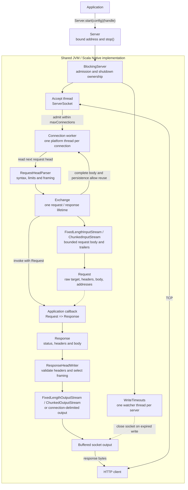

# Architecture

The same blocking HTTP/1 core runs on JVM and Scala Native. Applications supply
configuration and a synchronous `Request => Response` callback.

Connections run concurrently; exchanges on each connection run sequentially.
Admission has no accepted-socket task queue: excess connections are closed.
The parser enforces an absolute request-head deadline; body reads use socket
timeouts, while the watcher bounds socket writes. Handler computation has no
execution deadline.

The exchange owns stream lifetimes and protocol decisions, including lazy
`100 Continue`, bodyless responses and connection reuse. A response writer may
still consume the request body. Unread request bodies and terminal framing
failures prevent reuse; unread bodies are not drained.

`Server.stop()` stops admission, closes idle/head-reading connections, allows
active exchanges the configured shutdown grace, then closes remaining sockets.
It signals owned infrastructure and joins threads within the remaining budget.
Applications own when to call it; there is no automatic shutdown hook.

The public API is in `potateh/src/ba/sake/potateh`; connection, exchange and codec
implementation details are in its `internal` package. Routing, authentication,
TLS and application formats belong outside this core.
